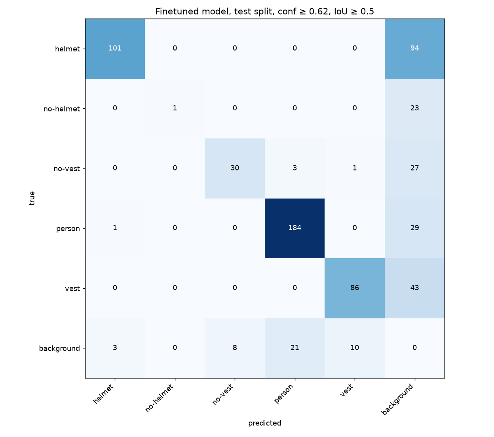
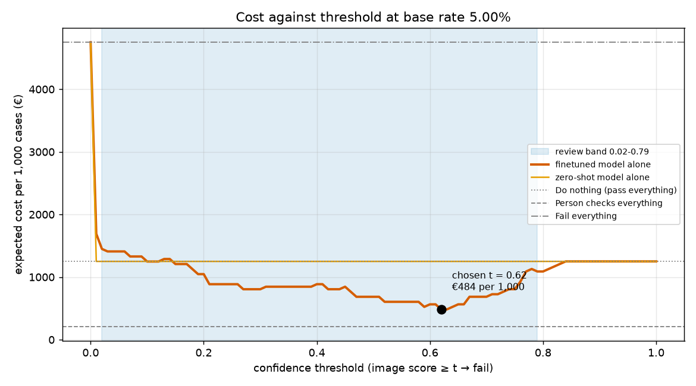

# Assignment 2 Report

- **Name**: Marco Celati
- **Student ID**: 19219
- **Email**: mcelati.ieu2022@student.ie.edu
- **Group**: BBADBA 5A

## Business problem, and the cost of being wrong

The business problem is that construction workers need to wear bright vests so vehicles and machinery can see them. 1 safety officer cannot watch all the cameras at once at all times without errors. Hence, violations go unnoticed and the construction site has an accident risk and a fine risk.

For each camera image, depending on if the worker is wearing his bright vest, the safety officer decides whether he needs to go stop the worker, or not, or if the model is unsure, it goes to human review and he checks whether or not the worker is wearing his vest.

So the model scores every image from each of the 5 cameras, and the safety officer is the one who acts on it.

If a worker is not wearing a vest and it is not detected by the model, the worker keeps working unsafely, and if a labour inspector catches him, there is a fine. Our firm's cost is 25 euros per missed image, so for each image where we don't detect it, but the worker in the image was being unsafe.

In the other case where we incorrectly stop a worker who actually was wearing his vest, it costs the firm 5 euros for each false alarm.

Hence, missing a worker is 5x worse than incorrectly stopping a safe worker.

## Dataset

Source: Roboflow Universe
Workspace: roboflow-100
Project: construction-safety-gsnvb
Version: 1
Link: https://universe.roboflow.com/roboflow-100/construction-safety-gsnvb/dataset/1 

One image is 640x640 pixels and has people in the image, on average 2.4 people in each image, since there are 2,362 total within the 997 images.
1 single image in our scenario is one snapshot from one of the 5 cameras at the construction site.

The classes are:
no-vest
vest
person
helmet
no-helmet

But the helmet and no-helmet classes don't trigger any action because there are very very few instances of no-helmet. In contrast the vest and no-vest are of course the main important component of this project.

The dataset serves the problem because it actually labels the specific condition the officer must act on (workers without their vests) alongside those complying (workers with their vests).

## What the dataset's composition implies

Splits: 997 train, 119 validation and 90 test images, and all of them are 640×640.

| Class | Train | Val | Test | Median box size (% of image) |
|---|---|---|---|---|
| helmet | 2,116 | 232 | 195 | 0.9% |
| no-helmet | 94 | 11 | 24 | 0.6% |
| no-vest | 741 | 90 | 61 | 4.5% |
| person | 2,362 | 241 | 214 | 10.5% |
| vest | 1,073 | 141 | 129 | 4.4% |

What it implies:
"no-helmet" only has 24 test instances, so very unreliable.

Further, it is unlike real footage as in the test set, 1 in 3 images shows a violation, whereas on a real site much much rarer in reality. The test set also has no empty scenes, and its images are ordinary photos rather than fixed-camera views.

Hence, I can't conclude how the model would do on real camera footage. The costs only make sense because the pipeline recalculated them for a 1 in 20 violation rate, which is the rate that happens in reality.

## Finetuning and baselines

Model: YOLO11n, object detection. Detection, because each scene has several workers and the model must find each one without a vest. The image's decision uses its highest "no-vest" confidence. The small "n" size suits a 1,206-image dataset and trains fast (50 epochs, image size 640, Colab T4, 13.6 minutes).

| Model (90 test images) | mAP50 | mAP50-95 | Image ROC AUC | Cost per 1,000 images |
|---|---|---|---|---|
| Finetuned YOLO11n | 0.786 | 0.429 | 0.903 | €484 alone, €146 with review |
| Zero-shot COCO YOLO11n | 0.169 | 0.092 | 0.500 | €1,250 |
| Trivial Baseline (predicts nothing) | 0.000 | 0.000 | 0.500 | €1,250 |

What changed: the zero-shot model only knows "person" (AP50 0.846) and has no idea what a vest is, hence for this decision it is no better than doing nothing. Finetuning taught it "no-vest" (AP50 0.659) and cut the cost by 61% alone, or 88% with review.

Was the gap expected? Yes, since COCO has no vest class. The surprise was "no-vest" dropping from 0.832 mAP50 on validation to 0.659 on test.

## Per-class evaluation and failure modes

| Class | Test instances | AP50 | Precision | Recall |
|---|---|---|---|---|
| helmet | 195 | 0.904 | 0.962 | 0.518 |
| person | 214 | 0.886 | 0.885 | 0.860 |
| vest | 129 | 0.864 | 0.887 | 0.667 |
| no-vest | 61 | 0.659 | 0.789 | 0.492 |
| no-helmet | 24 | 0.617 | 1.000 | 0.042 |

Precision and recall are measured at my threshold of 0.62. A predicted box only counts as correct if it overlaps the real box with an IoU of at least 0.5.

The overall mAP50 of 0.786 mostly comes from helmet, person and vest. The class I actually need, no-vest, is one of the weakest: at 0.62 the model only finds about half of the workers without a vest. No-helmet barely works at all (recall 0.04), which makes sense with only 94 training examples.

The confusion matrix shows the model rarely mixes classes up. Its problem is that it misses things. Out of 61 workers without a vest, it found 30 and missed 27 completely, and it called only 1 of them "vest". It also drew 8 no-vest boxes where nothing was labelled. The other classes look similar: helmets are tiny and get missed 94 times out of 195.

Looking at the failure images in artifacts/failures/, two of the six missed images got a score of 0.000, so the model didn't see the violation at all. Half of the misses are scenes where some workers wear a vest and others don't. The two false alarms (scores 0.78 and 0.70) are interesting: neither image has a vest or no-vest label on anyone, so the model might actually be right and the labels incomplete.

## Cost matrix and operating point

| Outcome | Cost | How I got it |
|---|---|---|
| False alarm | €5 | About 12 minutes of the officer's and the worker's time, at €24.88/h (INE average labour cost, Q1 2026) |
| Miss | €25 | 0.5% chance an inspector sees it × €2,451 (lowest fine for a serious safety breach, LISOS art. 40.2), plus 0.025% chance of an accident × roughly €50,000 (my own estimate) |
| Correct catch or correct pass | €0 | |
| Review by the officer | €0.21 | 30 seconds at €25/h |

I assumed 5% of images show someone without a vest, since most workers wear one most of the time. The test set has 34%, so every cost is recalculated at 5%.

On its own, the model is cheapest at a threshold of 0.62, which costs €484 per 1,000 images (12.9 misses and 32.2 false alarms). Doing nothing costs €1,250. The threshold isn't lower even though a miss costs five times more, because violations are rare, so most medium scores turn out to be clean images. If 20% of images had a violation, or a miss cost €100, the best threshold would drop to 0.27. The next section adds the review band.

The number I'm least sure of is the €25 miss cost. Changing it moves the threshold, which is already unstable: in most bootstrap resamples the best threshold lands somewhere between 0.27 and 0.70. What doesn't change is the overall decision. Model plus review stays the cheapest option for any miss cost between €0.40 and €1,577, and as long as a review takes under 7 minutes.

## What a person still has to check

Images scoring below 0.02 pass, 0.79 or above fail, and the rest go to the safety officer. That's 31% of images, about 377 a day. At 30 seconds each, it's roughly 3 hours of work, which fits within one officer's 5 hours with time left for other tasks. The band is wide because a review costs €0.21 and a miss costs €25, so even slightly suspicious images are worth a look. One weak point: I assumed the officer never makes mistakes, which is unlikely after hundreds of images a day.

| Strategy | Per 1,000 images | Per day | Missed per day | People needed |
|---|---|---|---|---|
| Do nothing | €1,250 | €1,500 | 60 | 0 |
| Person checks everything | €208 | €250 | 0 | 2 |
| Model alone | €484 | €580 | 15.5 | 0 |
| Model + review | €146 | €175 | 3.9 | 0.63 |

Model plus review is the cheapest option one officer can handle. Checking everything costs about the same but needs two people. With only 90 test images, the €146 is a rough figure, likely somewhere between €59 and €271.

## Limitations & next steps

- The test set is small (90 images, 31 with a violation), so my costs are rough. I'd label around 1,000 images from the real site cameras.
- The images are photos, not fixed-camera footage, and none are empty scenes. I'd collect real footage, including empty areas, and retrain on it.
- Images 2 minutes apart often show the same worker, so one violation can be counted several times. I'd track workers and count each violation once.
- I assumed the officer never makes mistakes. I'd test them on labelled images and use their real error rate.
- The model misses about half of the workers without vests. A bigger model (YOLO11s) and more no-vest examples should help.
- No-helmet is unusable with only 94 training examples, so helmet alerts would need more data first.

## Generative AI use disclosure

I used Claude to write parts of the code and make the dashboard. Also, when deciding my dataset, I used Claude to brainstorm various potential datasets from which to choose from. Lastly, I used Claude to doublecheck the formatting and spelling checks of my report.